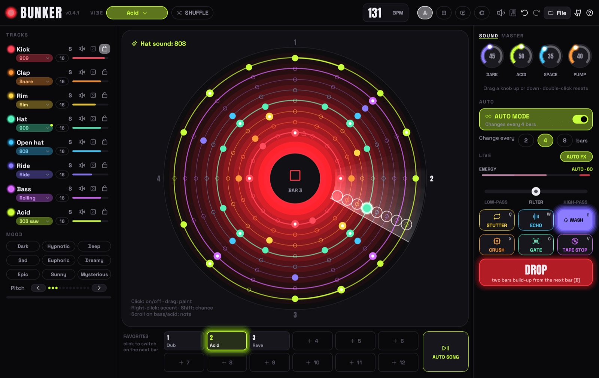

<p align="center">
  
</p>

<h1 align="center">BUNKER</h1>

<p align="center">
  <b>Techno beats in orbit.</b><br>
  A drum machine for people who have never used one – press play, pick a vibe, hit DROP.
</p>

<p align="center">
  <a href="https://github.com/tj537/bunker/releases/latest"></a>
  
  
  
  <a href="LICENSE"></a>
</p>

<p align="center">
  <a href="https://github.com/tj537/bunker/releases/latest/download/Bunker-macos-universal.zip"></a>
  &nbsp;
  <a href="https://github.com/tj537/bunker/releases/latest/download/Bunker-windows-x64.zip"></a>
</p>



Bunker is a techno drum machine written in Rust. Every sound is a glowing ring, every step a dot, and a beam of light circles like a radar. Kick, clap, hats, bass and a 303-style synth are synthesized live: no samples, no plug-ins, no account, no tracking. It's a download of a few megabytes for macOS and Windows.

## Why Bunker

**You don't need to know anything about music to use it.**

- **Grooves that already work.** Pick a vibe and Bunker rolls a pattern that follows the genre's rules: four on the floor, claps on 2 and 4, a bassline that dodges the kick, bass and synth on the same chord. It sounds like techno from the first second.
- **Words instead of theory.** You don't pick a scale or a chord progression. You pick a mood: *Dark, Hypnotic, Deep, Sad, Euphoric, Dreamy, Epic, Sunny, Mysterious*. Each brings its own chords, so the bars move instead of repeating. Tempo and swing come with the vibe. Or pick *Custom* and start from an empty pattern.
- **Nothing can go off-beat.** Pattern switches, drops and song parts wait for the next bar. Recorded hits snap to the nearest step.
- **One fader from intro to drop.** The energy fader is the arrangement, not the volume: low is a break, the middle is the groove, 90 and up is a drop.
- **A song without a timeline.** Save up to four patterns, press SONG, and Bunker plays a whole track with them: intro, groove, break, build-up, drop, outro.
- **Nothing to break.** <kbd>⌘</kbd>/<kbd>Ctrl</kbd>+<kbd>Z</kbd> undoes every change, a shuffle too. Your work is saved automatically.

**And if you do know what you're doing,** you still get per-step accents, slides and probability, loop lengths, tune and decay per track, a master EQ, MIDI in and WAV recording.

## What it does

- **Ten vibes:** Dub, Minimal, Melodic, Hypnotic, Electro, Peak time, Acid, Rave, Industrial, Hard. Each has its own tempo, sounds and pattern rules. **SHUFFLE** (<kbd>Enter</kbd>) rolls a new groove. **Custom** starts from an empty pattern for you to paint.
- **Eight tracks, 34 sounds:** five kicks (909, 808, Hard, Deep, Punch), clap, snare and snap, rim, cowbell, clave and toms, closed and open hats, rides, five basses (rolling, sub, reese, pulse, donk), and a synth that plays 303 saw or square, chord stabs, plucks or a rave hoover. Every track also has tune, decay, solo, mute, a dice for a new rhythm, and a lock that keeps shuffles away from it.
- **The orbit:** click to switch a step, drag to paint, right-click for an accent or slide, shift-click for probability, scroll to change a note. A loop of 8 or 4 steps repeats around its ring in time with the beam; set it to 12 or 15 by hand and it drifts against the others. <kbd>Tab</kbd> switches to eight pads and a classic step grid. **RECORD** (top bar or <kbd>R</kbd>) writes what you play on the pads, the keys or a MIDI keyboard into the pattern, on the beat – and lets that track in if the energy had it out.
- **Energy and drop:** the energy fader changes what plays, never how loud. Under 30 it's a break: no kick, no bass, the sound closes and opens into the reverb. Going up, kick, bass, open hat and ride come in on the beat. **DROP** turns the groove itself into a two-bar build-up (a kick roll, running hats, the riff looping and lifting an octave), then half a beat of silence, then everything hits. Pushing the fader into its red **drop zone** (90 and up) does the same – so you can take a track from intro to drop with one slider.
- **Patterns and songs:** four pattern slots that switch on the next bar with a clap roll. **SONG** plays a form (*Short*, *Club* or *Hypnotic*) with your patterns and steers the energy, the breaks and the drops. Click a part in the song strip to jump there. Everything you hear during a song is recorded, live moves included; when it ends, save it as a WAV.
- **Auto mode:** Bunker plays an endless set on its own. It changes one thing every 2, 4 or 8 bars – a pattern, a sound, the notes – and plays fills; every few drops a new chapter brings one or two bigger changes. The **AUTO FX** switch decides who arranges:
  - **On:** Bunker does everything. Its energy glides through cycles of 32 to 64 bars with breakdowns of four kinds, build-ups and drops, the build-ups in different styles (a high-pass rise, a low-pass that closes, a gate that chops harder, an echo thrown into the silence). The energy bar shrinks to a slim display.
  - **Off:** the energy bar is yours and decides what plays – low is a break, 85 is everything, 90 drops. The auto mode keeps changing patterns, sounds and notes but never takes a track out and never breaks or drops by itself.
- **Live effects (hold to use):** stutter, echo, wash, crush, gate and tape stop, plus a spring-back filter. The sound knobs are DARK, ACID, SPACE and PUMP. The master page has LOW, MID, HIGH and DRIVE.
- **Visualizer:** <kbd>P</kbd> turns the window into a fullscreen light show (a spectrum ring, kick shockwaves, a star field) for the big screen – no text, just a small energy bar at the bottom. All keys keep working, so <kbd>←</kbd> <kbd>→</kbd> take the set from break to drop.
- **Files:** `.bunker` files (plain text) keep the groove and all four patterns.
- **Plug and play:** the speaker in the top bar sets the volume (click or scroll). Headphones and MIDI keyboards are picked up while Bunker runs. On startup, Bunker asks GitHub once whether there is a new version. You can switch that off.

## Under the hood

- **Rust 2021**, about 9k lines with no `unsafe` code. The UI is immediate-mode [egui](https://github.com/emilk/egui)/eframe 0.31. Audio goes out through [cpal](https://github.com/RustAudio/cpal), MIDI comes in through [midir](https://github.com/Boddlnagg/midir), and files are [RON](https://github.com/ron-rs/ron) via serde.
- **Real-time audio thread.** The engine renders inside the device callback without locks, blocking or file I/O. The UI sends commands over an `mpsc` channel and reads the playhead, hit lights, levels and spectrum from atomics. When the engine changes the song itself (auto mode, song mode, recording), it sends the new song back as an event.
- **Copyable song model.** A `Song` is plain fixed-size data with no `Vec` or `String`, so it can be swapped between threads cheaply. New fields use `#[serde(default)]`, so older saves and files keep loading.
- **All DSP is hand-written:** TPT state-variable filters, PolyBLEP saws, a 303-style voice with accent and slide, 808-style metallic hats from six detuned squares, a Freeverb-style reverb, a ping-pong delay, a kick rumble, saturation and a limiter. Every sound is synthesized from scratch.
- **Recording without stalls.** In song mode the audio thread hands what it renders to the UI in 32k-sample pieces over the same channel; the UI keeps them as 16-bit and writes the WAV on a worker thread.
- **Deterministic and tested.** Randomness comes from a seedable RNG, so patterns and renders are repeatable. The test suite checks the genre rules for every vibe, timing, drops, songs, clipping (peak ≤ 1.0) and the file format. An offscreen renderer draws the real UI to PNG for visual checks without touching the desktop.
- **CI and releases** run on GitHub Actions. They check fmt, `clippy -D warnings` and the tests on Linux, macOS and Windows. A tag builds a universal (arm64 + x86_64) macOS app and a Windows exe and publishes them with SHA-256 checksums.

More detail is in [docs/ARCHITECTURE.md](docs/ARCHITECTURE.md).

## Keys

- <kbd>Space</kbd>: play / stop
- <kbd>Enter</kbd>: shuffle a new groove
- <kbd>A</kbd>–<kbd>K</kbd>: the eight pads
- <kbd>1</kbd>–<kbd>8</kbd>: mute / unmute a track
- <kbd>←</kbd> <kbd>→</kbd>: energy down / up
- <kbd>↑</kbd> <kbd>↓</kbd>: tempo
- <kbd>B</kbd>: build-up and drop
- <kbd>Q</kbd> <kbd>W</kbd> <kbd>E</kbd> <kbd>X</kbd> <kbd>C</kbd> <kbd>V</kbd> (hold): stutter, echo, wash, crush, gate, tape stop
- <kbd>R</kbd>: record on / off
- <kbd>Tab</kbd>: orbit ↔ pads
- <kbd>P</kbd>: visualizer
- <kbd>⌘</kbd>/<kbd>Ctrl</kbd>+<kbd>Z</kbd>: undo (add <kbd>Shift</kbd> to redo)
- <kbd>Esc</kbd>: close a window or leave the visualizer

## MIDI

Bunker connects to every MIDI keyboard it finds, including ones you plug in later.

- **Keys below middle C** play the sounds: C kick, D clap, E rim, F hat, G open hat, A ride, B bass (the black keys fill in).
- **Keys from middle C up** (hold) transpose bass and synth live.
- **Mod wheel:** acid. **Pitch bend:** filter. **Sustain pedal:** echo.
- **Knobs:** CC 70–73 (the Akai MPK mini default) or CC 74/71/91/93 control energy, dark, acid and space.

## Install

**macOS 11+** (Apple Silicon and Intel): download [`Bunker-macos-universal.zip`](https://github.com/tj537/bunker/releases/latest/download/Bunker-macos-universal.zip), unzip it and move Bunker to Applications. The app isn't notarized yet, so on first launch right-click it and choose *Open*, or use *System Settings → Privacy & Security → Open Anyway*.

**Windows 10/11:** download [`Bunker-windows-x64.zip`](https://github.com/tj537/bunker/releases/latest/download/Bunker-windows-x64.zip), unzip it and run `Bunker.exe`. There is no installer and no admin rights are needed. SmartScreen may ask once: *More info → Run anyway*.

Every release has a `SHA256SUMS.txt`.

## Build it yourself

You need [Rust](https://rustup.rs). On Linux you also need `libasound2-dev` and `libgtk-3-dev`.

```bash
cargo run --release
```

```bash
cargo test --release
```

```bash
cargo test --release render_ -- --ignored
```

The last command writes UI screenshots and demo loops (WAV) to `target/snapshots/`. On a Mac, `./scripts/build-mac.sh --install` builds `Bunker.app` and copies it to Applications.

## Credits

Built with [egui](https://github.com/emilk/egui), [cpal](https://github.com/RustAudio/cpal) and [midir](https://github.com/Boddlnagg/midir). The fonts are [Space Grotesk](https://github.com/floriankarsten/space-grotesk) and [Anton](https://github.com/googlefonts/AntonFont) (SIL Open Font License), and the icons are from [Phosphor](https://phosphoricons.com).

Made by Tom, together with Claude. MIT licensed.
