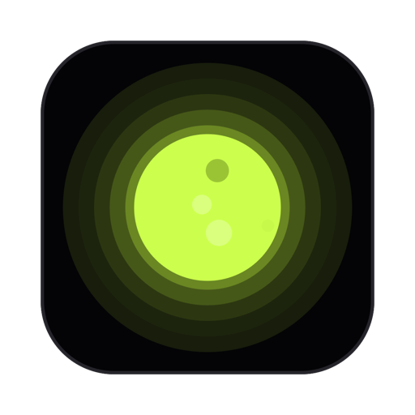
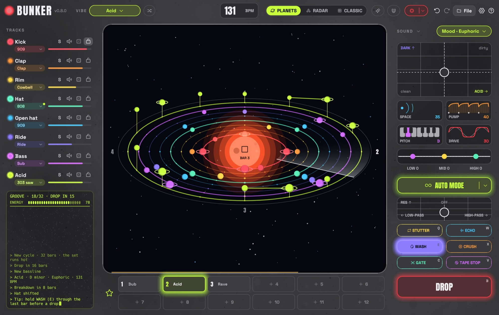

<p align="center">
  
</p>

<h1 align="center">SOLARUM</h1>

<p align="center">
  <b>Techno from another planet – easy to use, beautiful to look at.</b><br>
  For everyone: kids, beginners, people who have never touched music software. Paint a beat on an empty solar system, or let Solari, the little robot, play a whole set for you.
</p>

<p align="center">
  <a href="https://github.com/tj537/solarum/releases/latest"></a>
  
  
  
  <a href="LICENSE"></a>
</p>

<p align="center">
  <a href="https://github.com/tj537/solarum/releases/latest/download/Bunker-macos-universal.zip"></a>
  &nbsp;
  <a href="https://github.com/tj537/solarum/releases/latest/download/Bunker-windows-x64.zip"></a>
</p>



Solarum is a techno drum machine written in Rust. Your groove is a little solar system: every track an orbit round the sun, every step a planet, and a beam of light sweeps round once a bar. Kick, clap, hats, bass and a 303-style synth are synthesized live: no samples, no plug-ins, no account, no tracking. It's a download of a few megabytes for macOS and Windows.

## Why Solarum

**Easy to use.** No timeline, no mixer, no menus full of words you don't know. Click a planet and it plays. Drag it up and it sings higher.

**Beautiful.** Your beat is a little solar system turning in deep space – every sound has its own colour, every beat lights up as the beam sweeps past.

**For everyone.** Kids, beginners and people without any tech or music experience make something that sounds good from the first click – and if you do know your way around, everything you'd expect is there.

**With an auto mode.** Switch on Solari, pick a vibe, and it builds a whole set by itself: grooves that change, breakdowns, build-ups and drops. You can jump in any time.

> **Still very much under development.** Solarum is young and changing fast. Feedback, criticism, ideas and help are more than welcome – [open an issue](https://github.com/tj537/solarum/issues), start a discussion or send a pull request.

**You don't need to know anything about music to use it:**

- **Grooves that already work.** Pick a vibe and Solarum rolls a pattern that follows the genre's rules: four on the floor, claps on 2 and 4, a bassline that dodges the kick, bass and synth on the same chord. It sounds like techno from the first second.
- **Words instead of theory.** You don't pick a scale or a chord progression. You pick a mood from the tempo box at the top – its menu shows every mood as a tile with its four chords as steps: *Dark, Hypnotic, Deep, Sad, Euphoric, Dreamy, Epic, Sunny, Mysterious* – or leave it on *Auto* and every shuffle picks one that suits the vibe. Solarum starts on *Neutral* (plain minor, no chord changes); the auto mode picks moods by itself. Each brings its own chords, so the bars move instead of repeating; a mood you pick stays through shuffles and the auto mode. Tempo and swing come with the vibe. Or pick *Custom* and start from an empty pattern.
- **Nothing can go off-beat.** Switching favorites, drops and song parts wait for the next bar, and every loop fits the bar.
- **One fader from intro to drop.** The energy fader is the arrangement, not the volume: low is a break, the middle is the groove, all the way up everything plays – it starts full. DROP does the drop.
- **A song without a timeline.** Save your favorite grooves, pick AUTO SONG from the arrow next to the record button, and Solarum plays a whole track with them: intro, groove, break, build-up, drop, outro.
- **Nothing to break.** <kbd>⌘</kbd>/<kbd>Ctrl</kbd>+<kbd>Z</kbd> undoes every change, a shuffle or the broom too (clear: an empty sky with every setting back at its start). The tempo box's menu has a metronome that clicks on every beat while you build. Your work is saved automatically.

**And if you do know what you're doing,** you still get per-step accents, slides and probability, tune and decay per track, a master EQ, MIDI in and WAV recording.

## What it does

- **Ten vibes:** Dub, Minimal, Melodic, Hypnotic, Electro, Peak time, Acid, Rave, Industrial, Hard. Each has its own tempo, sounds and pattern rules. They live in the auto mode's terminal: pick one there, and **SHUFFLE** (<kbd>Enter</kbd>) rolls a new groove – always clearly different from the one before, sometimes busier, sometimes sparser. **Custom** starts from an empty pattern for you to paint.
- **Eight tracks, 34 sounds:** five kicks (909, 808, Hard, Deep, Punch), clap, snare and snap, rim, cowbell, clave and toms, closed and open hats, rides, five basses (rolling, sub, reese, pulse, donk), and a synth that plays 303 saw or square, chord stabs, plucks or a rave hoover. Click a track's name to hear its sound. Every track also has tune, decay, solo, mute, a dice for a new rhythm, and a lock that keeps shuffles away from it.
- **Planets**, the main view: the groove as a little solar system seen from an angle. Every track is an orbit round the sun, every step that plays a planet on it – accents wear a ring like Saturn, half behind the planet. A radar beam sweeps round once a bar and every planet it passes lights up and sends out a ring. Bass and synth planets float on stalks – the higher the note, the higher they float. The sun is the play button.
- **Editing:** click to switch a step, drag to paint, right-click a step for its menu – on, accent, slide, how often it plays and, on bass and synth, the note from the scale. Shift-click and the mouse wheel are shortcuts for how often and the note. In the planets view you can simply grab a bass or synth planet and drag it up or down: it moves through the scale, and a ladder beside it shows the degree – 0 is the root, then +1, +2 … up or -1, -2 … down – and the note's name.
- **PLANETS | CLASSIC** at the top (or <kbd>Tab</kbd>) shows the same groove as eight pads and a step grid. The older **Radar** view (flat rings of dots with a sweeping beam) can be switched on in the settings as a legacy view.
- **Energy and drop:** the energy fader changes what plays, never how loud. Under 30 it's a break: no kick, no bass, the sound closes and opens into the reverb. Going up, kick, bass, open hat and ride come in on the beat; a track the energy takes out is muted – the mute button shows it, by hand and in the auto mode alike, even while stopped The sun shines in the energy's colour, icy blue in a break, lime when full (red through a build-up). **DROP** turns the groove itself into a two-bar build-up (a kick roll, running hats, the riff looping and lifting an octave, a gate chopping harder and harder), then half a beat of silence, then everything hits.
- **Favorites and songs:** twelve slots in two rows to keep grooves, each with a name you give it (right-click → Rename). A click switches on the next bar with a clap roll; the lit one is exactly what plays and goes dark once the auto mode changes the groove. **AUTO SONG** (the arrow next to the record button) turns favorite 1 into a whole track – *Short*, *Club* or *Hypnotic*: it starts quietly with the hats under a closed filter, brings the tracks in one by one, keeps the grooves moving with a gentle change every 8 bars, eases into each break, and drops two or three times – the first time after about half a minute. Favorite 2 takes over after the first drop and favorite 1 returns for the last (with only one favorite, every drop is a new chapter of it); the outro winds down track by track. The song steers the energy; the bar shows where it is. Click a part in the song strip to jump there. A song records itself; when it ends, save it as a WAV.
- **Record your set:** the red record button in the top bar (or <kbd>R</kbd>) records everything you hear – whatever plays, the auto mode, songs, effects – with a running timer; pressed while stopped it waits for play, and a pause is left out, until you click it again. Then a save dialog asks where the WAV should go.
- **Auto mode:** Solarum plays an endless set on its own. Solarum starts with an empty sky and everything by hand – the sound section open, your last groove one undo away. The auto mode is the little computer on the left: switch it on with its power button and its terminal boots up – the music starts, Solari, a little robot, waves and says it's taking over, and the sound section folds away. Solari keeps the beat you built and fills in what's missing – one track per bar, so an empty sky builds up from the kick; switch it off and the screen goes dark. Its settings are in the terminal itself. It thinks in 8-bar phrases: a bigger change opens a phrase – a pattern, a sound, new notes, taking turns between drums and bass/synth – small touches come in between (every 1 to 16 bars – SET in the terminal), and a fill closes it, a bigger one every 16 bars. Every few drops a new chapter brings one or two bigger changes, most likely after the peak. The **AUTO FX** switch, under SET too and on by default, decides who arranges:
  - **On:** Solarum does everything. Its energy glides through cycles of 32 to 64 bars with breakdowns of four kinds (or none – a rolling cycle), build-ups and drops, climbing a step every phrase. Like a DJ set it has an arc: each cycle runs a little hotter than the last until a short, stripped-down peak, then the set breathes out into a longer, calmer cycle and climbs again. Every build-up comes with a gate that chops harder and harder. Whatever it takes out it mutes, so you always see it on the mute buttons. It also plays with the mix a little – track volumes, DARK, SPACE and the master EQ wander gently around where you set them, and a knob you touch is yours. The energy then shows as a level meter in the log.
  - **Off:** the energy bar is yours and decides what plays – low is a break, up from 85 everything plays; DROP drops. The auto mode keeps changing patterns, sounds and notes but never takes a track out and never breaks or drops by itself.
- **The terminal** – the auto mode's screen – types out, like an old computer, everything Solarum says and does – and in the auto mode where the set is, when the breakdown and the drop come, and how hot the set runs; during a song it follows the song. Now and then it adds where the set stands (minutes, drops), what plays (vibe, key, mood, tempo) or a tip.
  It's a little operating system, **SOLAR OS**: the title bar has **SET** (how often Solari changes something, AUTO FX) and **OFF**, the menu below it **VIBE** (a pick rolls a groove in it) and **SHUFFLE**, and at the bottom Solari's prompt: type `shuffle`, `vibe acid` (or just `acid`), `vibes`, `drop`, `fx off`, `every 8`, `mood dark`, `bpm 135`, `status`, `joke`, `help` or `off`.
- **The sound** sits at the top right (a click on SOUND shows or folds it):
  - a **character pad** – drag up for DARK, right for ACID;
  - **SPACE, PUMP, KEY and DRIVE** as little pictures of what they do – echoes rippling out, the mix ducking under the kick, a KEY slider (the key the whole song is in; the planets' own notes are steps of the scale, so the melody stays), a wave pushed into saturation – all dragged up or down;
  - the **master EQ** as a curve with three points to drag.

  Double-click resets. When the auto mode sweeps the acid or a breakdown sweeps the filter, the pucks move with it.
- **Live effects (hold to use):** stutter, echo, wash, crush, gate and tape stop – each button shows what it does in a picture (a slice repeating, echoes fading, waves smearing, a wave in stairs, a chopped sound, a wave slowing down) that moves when the mouse is on it, runs faster while the effect is on and bursts out of the button when you press it – plus a **filter pad**: drag left for low-pass, right for high-pass, up for resonance – it springs back when you let go. When Solarum uses an effect by itself – the gate in every build-up – its button lights up and flickers with the chop.
- **Two visualizers** for the big screen with no text, just a small energy bar at the bottom – both behind the sparkle button at the top, each with a little picture. LIGHTS goes fullscreen; FACE opens in a window of its own, so you can drag it to a projector and keep playing (double-click or <kbd>F</kbd> for fullscreen):
  - **LIGHTS** (<kbd>P</kbd>): a spectrum ring, kick shockwaves and a star field.
  - **FACE** (<kbd>O</kbd>): a low-poly head in space that nods in time, with empty eye holes like a mask's – you see the stars through them – and a black slit for a mouth that now and then falls open, corners down. They glow with the kick, its edges flicker with the hats. In a build-up it warps, glitches, splits into red and blue, nods twice as fast and its mouth starts to tear open; on the drop it rushes at you, tears its mouth open and screams with lasers blazing from its eyes, cracks glow through its face, and it bursts into shards that fly out of the picture and come back together.

  All keys keep working, so <kbd>←</kbd> <kbd>→</kbd> take the set from break to drop.
- **Start screen:** Solarum opens on a start screen like an app: the name, *New project*, *Open…*, *Back to …* (the project that's open, or was last time), *Let Solari play* (pick a vibe first – Hypnotic, Acid, Peak time, Dub, Melodic, Hard, or let Solari choose), the green sun from the planets view (click it and it glows red), and your recent projects as cards with a little picture of each groove – as many as the window has room for. The logo brings it back; File → Save writes to the project's file (⌘/Ctrl + S), Save as… asks where.
- **Projects:** a project is one `.solarum` file (plain text): the groove and its twelve favorites with their names. *New project* starts without favorites; the top bar shows the project's name and a dot when it has changes, and leaving a project with unsaved changes asks whether to save.
- **Settings (the gear):** volume, the sound output, the MIDI keyboard, what happens when Solarum opens (wait or play – the auto mode is always off at the start), whether a shuffle keeps the tempo, facts and tips in the terminal, the legacy Radar view and the update check (Solarum asks GitHub once at start whether there is a new version – you can switch that off). Headphones and MIDI keyboards are picked up while Solarum runs. The LIVE heading folds the live controls away.

## Under the hood

- **Rust 2021**, about 14k lines with no `unsafe` code. The UI is immediate-mode [egui](https://github.com/emilk/egui)/eframe 0.31. Audio goes out through [cpal](https://github.com/RustAudio/cpal), MIDI comes in through [midir](https://github.com/Boddlnagg/midir), and files are [RON](https://github.com/ron-rs/ron) via serde.
- **Real-time audio thread.** The engine renders inside the device callback without locks, blocking or file I/O. The UI sends commands over an `mpsc` channel and reads the playhead, hit lights, levels and spectrum from atomics. When the engine changes the song itself (auto mode, song mode, recording), it sends the new song back as an event.
- **Copyable song model.** A `Song` is plain fixed-size data with no `Vec` or `String`, so it can be swapped between threads cheaply. New fields use `#[serde(default)]`, so older saves and files keep loading.
- **All DSP is hand-written:** TPT state-variable filters, PolyBLEP saws, a 303-style voice with accent and slide, 808-style metallic hats from six detuned squares, a Freeverb-style reverb, a ping-pong delay, a kick rumble, saturation and a limiter. Every sound is synthesized from scratch.
- **Recording without stalls.** While recording, the audio thread hands what it renders to the UI in 32k-sample pieces over the same channel; the UI keeps them as 16-bit and writes the WAV on a worker thread.
- **Deterministic and tested.** Randomness comes from a seedable RNG, so patterns and renders are repeatable. The test suite checks the genre rules for every vibe, timing, drops, songs, clipping (peak ≤ 1.0) and the file format. An offscreen renderer draws the real UI to PNG for visual checks without touching the desktop.
- **CI and releases** run on GitHub Actions. They check fmt, `clippy -D warnings` and the tests on Linux, macOS and Windows. A tag builds a universal (arm64 + x86_64) macOS app and a Windows exe and publishes them with SHA-256 checksums.

More detail is in [docs/ARCHITECTURE.md](docs/ARCHITECTURE.md).

## Keys

- <kbd>Space</kbd>: play / stop
- <kbd>Enter</kbd>: shuffle a new groove
- <kbd>A</kbd>–<kbd>K</kbd>: the eight pads
- <kbd>1</kbd>–<kbd>8</kbd>: mute / unmute a track
- <kbd>←</kbd> <kbd>→</kbd>: energy down / up
- <kbd>↑</kbd> <kbd>↓</kbd>: tempo
- <kbd>B</kbd>: build-up and drop
- <kbd>Q</kbd> <kbd>W</kbd> <kbd>E</kbd> <kbd>X</kbd> <kbd>C</kbd> <kbd>V</kbd> (hold): stutter, echo, wash, crush, gate, tape stop
- <kbd>R</kbd>: record your set on / off
- <kbd>Tab</kbd>: planets → classic (→ radar, when it's on)
- <kbd>P</kbd>: LIGHTS visualizer
- <kbd>O</kbd>: FACE visualizer
- <kbd>⌘</kbd>/<kbd>Ctrl</kbd>+<kbd>Z</kbd>: undo (add <kbd>Shift</kbd> to redo)
- <kbd>Esc</kbd>: close a window or leave the visualizer

## MIDI

Solarum connects to every MIDI keyboard it finds, including ones you plug in later.

- **Keys below middle C** play the sounds: C kick, D clap, E rim, F hat, G open hat, A ride, B bass (the black keys fill in).
- **Keys from middle C up** (hold) transpose bass and synth live.
- **Mod wheel:** acid. **Pitch bend:** filter. **Sustain pedal:** echo.
- **Knobs:** CC 70–73 (the Akai MPK mini default) or CC 74/71/91/93 control energy, dark, acid and space.

## Install

**macOS 11+** (Apple Silicon and Intel): download [`Bunker-macos-universal.zip`](https://github.com/tj537/solarum/releases/latest/download/Bunker-macos-universal.zip), unzip it and move Solarum to Applications. The app isn't notarized yet, so on first launch right-click it and choose *Open*, or use *System Settings → Privacy & Security → Open Anyway*.

**Windows 10/11:** download [`Bunker-windows-x64.zip`](https://github.com/tj537/solarum/releases/latest/download/Bunker-windows-x64.zip), unzip it and run `Solarum.exe`. There is no installer and no admin rights are needed. SmartScreen may ask once: *More info → Run anyway*.

Every release has a `SHA256SUMS.txt`.

## Build it yourself

You need [Rust](https://rustup.rs). On Linux you also need `libasound2-dev` and `libgtk-3-dev`.

```bash
cargo run --release
```

```bash
cargo test --release
```

```bash
cargo test --release render_ -- --ignored
```

The last command writes UI screenshots and demo loops (WAV) to `target/snapshots/`. On a Mac, `./scripts/build-mac.sh --install` builds `Solarum.app` and copies it to Applications.

## Credits

Built with [egui](https://github.com/emilk/egui), [cpal](https://github.com/RustAudio/cpal) and [midir](https://github.com/Boddlnagg/midir). The fonts are [Space Grotesk](https://github.com/floriankarsten/space-grotesk) and [Anton](https://github.com/googlefonts/AntonFont) (SIL Open Font License), and the icons are from [Phosphor](https://phosphoricons.com).

Made by Tom, together with Claude. MIT licensed.
