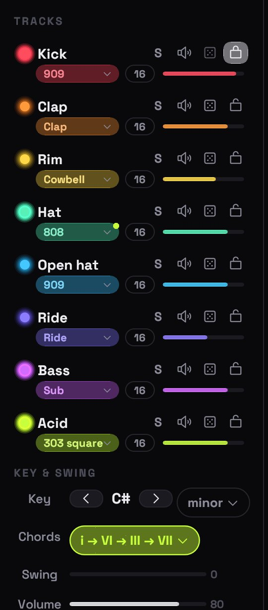
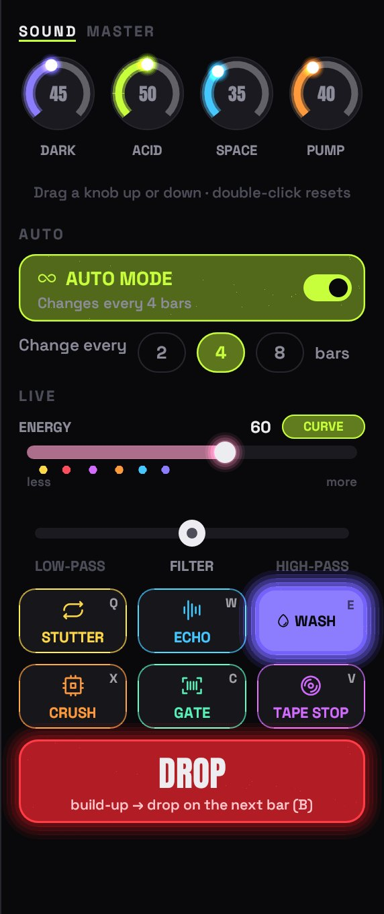
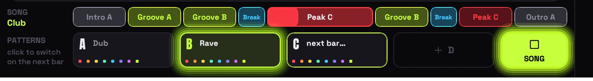
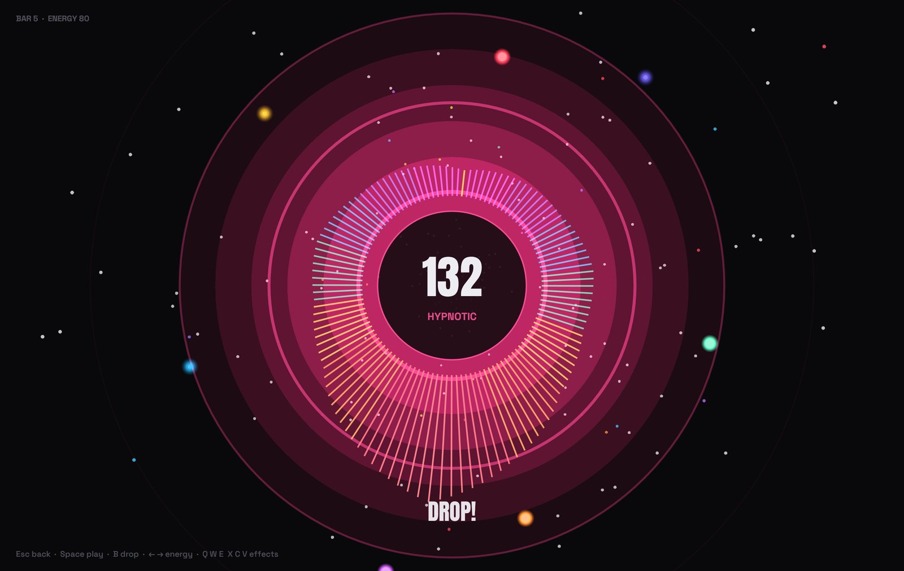
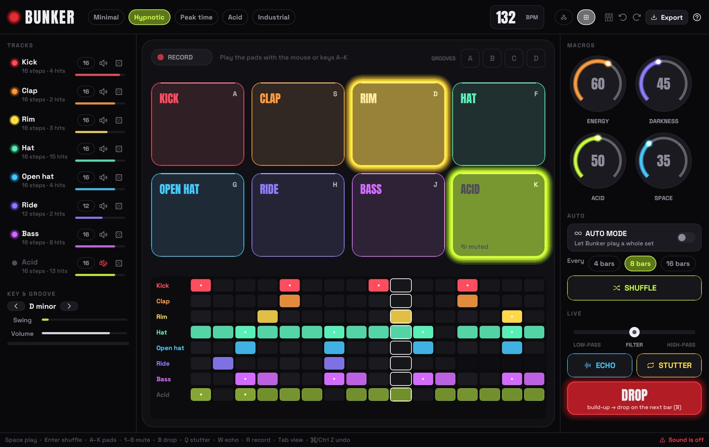

<p align="center">
  
</p>

<h1 align="center">BUNKER</h1>

<p align="center">
  <b>Techno beats in orbit.</b><br>
  A drum machine for people who have never used one – press play, pick a vibe, hit DROP.
</p>

<p align="center">
  <a href="https://github.com/tj537/bunker/releases/latest"></a>
  
  
  
  <a href="LICENSE"></a>
</p>

<p align="center">
  <a href="https://github.com/tj537/bunker/releases/latest/download/Bunker-macos-universal.zip"></a>
  &nbsp;
  <a href="https://github.com/tj537/bunker/releases/latest/download/Bunker-windows-x64.zip"></a>
</p>


Every sound is a glowing ring, every step a dot, a beam of light circles like a radar. Pick one of **ten vibes**, give every track **its own sound**, keep grooves as **patterns** and let Bunker turn them into a **song** – or switch on the **auto mode** and let Bunker play a whole set with fills, breakdowns and drops while you ride the **energy fader** and the **live effects**. Then switch to the **visualizer** and put it on the big screen.

Written in Rust, every sound synthesized live – no samples, no account, no tracking.

> 🇩🇪 **Kurz auf Deutsch:** Bunker ist eine Techno-Drum-Machine zum Ausprobieren, ganz ohne Vorwissen. Jeder Sound ist ein leuchtender Ring, jeder Punkt ein Schritt – klicken, und es groovt. Oben wählst du einen von zehn **Vibes** (Dub bis Hard Techno), jede Spur hat mehrere **Sounds** (909, 808, Snare, Cowbell, Reese, Stab, Hoover …) mit **Tune & Decay** und lässt sich **sperren**. Mit dem **Energie-Fader** baust du den Groove ab und wieder auf, dann **DROP**. Vier **Patterns** speichern Grooves, ein Klick wechselt auf den nächsten Takt. **SONG** macht daraus einen ganzen Track (Intro, Groove, Break, Drop, Outro). Statt Fachbegriffen gibt es **Stimmungen** (Dark, Hypnotic, Deep, Sad, Euphoric) und **Groove**-Knöpfe (Straight bis Shuffle). Der **Auto-Modus** spielt selbstständig ein ganzes Set mit Energie-Kurve, Fills, Breakdowns und Drops. Dazu sechs **Live-Effekte**, **Pump**, **Master-EQ**, ein **Visualizer** für den Beamer, `.bunker`-Dateien, WAV-Export und MIDI-Keyboards. Läuft auf Mac und Windows, alles wird live synthetisiert, und Bunker sagt Bescheid, wenn es ein Update gibt.

---

## ✨ What's inside

<table>
<tr>
<td width="50%" valign="top">

### 🎛️ Ten vibes
**Dub · Minimal · Melodic · Hypnotic · Electro · Peak time · Acid · Rave · Industrial · Hard** – pick one from the **VIBE** dropdown at the top and it rolls a new groove that follows the rules of the genre: four on the floor (or broken electro kicks), claps on 2 and 4, a bassline that dodges the kick, chords that agree with the bass. Each vibe brings its own tempo, key, swing and sounds. **SHUFFLE** (<kbd>Enter</kbd>) rolls again.

### 🥁 A sound for every track
Click the coloured pill under a track name (or scroll on it):

| Track | Sounds |
|---|---|
| Kick | 909 · 808 · Hard · Deep · Punch |
| Clap | Clap · Snare · Big clap · Snap |
| Rim | Rim · Cowbell · Clave · Tom · Blip |
| Hat / Open hat | 909 · 808 · Shaker · Tick / Sizzle |
| Ride | Ride · Bell · Dark |
| Bass | Rolling · Sub · Reese · Pulse · Donk |
| Synth | 303 saw · 303 square · Stab · Pluck · Hoover |

Under the list: **Tune** (±12 semitones) and **Decay** (shorter or longer) for that track. **S** solos a track, the speaker mutes it, the 🎲 rolls a new rhythm for just that track, the 🔒 **locks** it – shuffle, vibes, the dice and the auto mode leave a locked track alone, in the orbit and in the pads.

</td>
<td width="50%" valign="top">

</td>
</tr>
<tr>
<td width="50%" valign="top">

</td>
<td width="50%" valign="top">

### 📈 Energy & drop
The **ENERGY** fader is the big lever: pull it down and the groove strips to hats and synth, push it up and kick, bass, clap, open hat and ride come back one by one (the coloured dots show where), with extra hats and drive at the top. Pull it down, hit **DROP** – from the next bar on the groove itself turns into the build-up: the kick rolls in quarters, 8ths, then 16ths, the hats run, bass and synth loop their first beat and jump an octave up, a clap roll and a noise riser on top – half a beat of silence, and everything hits. <kbd>←</kbd> <kbd>→</kbd> on the keyboard.

The red end of the fader is the **drop zone**: push the energy to **90** or more and the build-up starts on the next bar, the drop lands two bars later. So pull it down, bring it back up slowly, and you know exactly when the drop comes. It starts again once you've been below 88.

### ♾️ Auto mode
Bunker plays a whole set on its own. Every **2, 4 or 8 bars** it changes one thing – a new pattern, another sound, new notes, a polyrhythm, a track in or out. Every 8 bars a **fill**. Every 32 bars a **breakdown** – a different kind each time – a build-up and the drop. After some drops a **new chapter** starts: new bassline, new sounds, sometimes a new key. The **energy curve** (CURVE) moves the energy through the set; touch the fader and it's yours.

### 🔥 Live effects
Hold them, combine them:
**STUTTER** <kbd>Q</kbd> · **ECHO** <kbd>W</kbd> · **WASH** <kbd>E</kbd> (the beat drowns in a huge reverb that rings out when you let go) · **CRUSH** <kbd>X</kbd> · **GATE** <kbd>C</kbd> · **TAPE STOP** <kbd>V</kbd> – plus a **filter** that springs back.

### 🎚️ Sound & master
**SOUND:** **DARK** closes the sound and adds rumble · **ACID** squeezes the synth filter · **SPACE** reverb and echo · **PUMP** everything ducks under the kick.
**MASTER:** **LOW**, **MID**, **HIGH** (±12 dB each) and **DRIVE** for the whole mix.

</td>
</tr>
</table>

### 🎬 Patterns & song



Four memory slots under the orbit. Click **+** to keep the groove you hear, click a full pattern to switch to it – while the beat runs it comes in on the next bar, with a clap roll before. The lit one keeps your changes; right-click to overwrite or clear.

**SONG** turns your patterns into a whole track. Pick a form – **Short** (~2 min, one drop), **Club** (~4–5 min, two drops) or **Hypnotic** (long, one big drop) – and Bunker plays intro, groove, break, build-up, drop and outro with your patterns, steering the energy itself. The strip above the patterns shows the parts and where you are; click a part to jump there on the next bar. Jam along all the way: change the pattern, hit the effects, DROP or the energy fader (it's yours until the next part). Empty patterns are filled in from the others, so it works with just one. The song ends after the outro.

### 🌌 Visualizer



<kbd>P</kbd> (or the screen icon at the top) turns the whole window into a fullscreen light show: a spectrum ring, shockwaves on every kick, a star field that speeds up with the energy, one moon per track. All keys keep working – play the drop and the effects while it runs. <kbd>Esc</kbd> goes back.

### And also

- **The orbit** – click a dot to switch a step, drag to paint, right-click for an accent (on the synth: slide), shift-click for chance, scroll on bass and synth dots to change the note. Give a ring fewer steps and it drifts against the others – polyrhythms you can *see*.
- **Pads** – <kbd>Tab</kbd> for eight big pads and a classic step grid. Play with the mouse or <kbd>A</kbd>–<kbd>K</kbd>, hit **RECORD** and your hits land on the nearest step.
- **Mood & groove** – **Dark · Hypnotic · Deep · Sad · Euphoric** pick the notes and chords bass and synth play (and give them fitting new notes), **Pitch** moves them lower or higher. **Straight · Loose · Bouncy · Shuffle** set the swing.
- **.bunker files** – *File → Save as .bunker file* keeps the groove and all four patterns in one small text file – to back up or share. Open it again from the menu or drag it onto the window.
- **Undo everything** – <kbd>⌘</kbd>/<kbd>Ctrl</kbd> + <kbd>Z</kbd> takes back any change, a shuffle too.
- **Export WAV** – *File → Export audio*: 4 to 64 bars, 44.1 kHz stereo, auto mode included.
- **Plug and play** – switch to headphones or plug in a MIDI keyboard while it runs; Bunker follows within a few seconds.
- **Update check** – Bunker asks GitHub once at start whether there is a new version and shows a green button if there is. Nothing else is sent; switch it off in the help window (<kbd>?</kbd>).



## 🎹 MIDI keyboard

Bunker connects to every MIDI keyboard it finds, also when you plug one in later.

| On the keyboard | Does |
|---|---|
| Keys **below middle C** | Play the sounds: C kick, D clap, E rim, F hat, G open hat, A ride, B bass (black keys fill in) |
| Keys **from middle C up** (hold) | Transpose bass and synth live – C4 is the original key |
| Mod wheel | Acid |
| Pitch bend | Filter |
| Sustain pedal | Echo |
| Knobs CC 70–73 (Akai MPK mini default) or CC 74/71/91/93 | Energy, Dark, Acid, Space |

## ⌨️ Keys

| Key | Does | | Key | Does |
|---|---|---|---|---|
| <kbd>Space</kbd> | Play / stop | | <kbd>Q</kbd> <kbd>W</kbd> <kbd>E</kbd> (hold) | Stutter, echo, wash |
| <kbd>Enter</kbd> | Shuffle a new groove | | <kbd>X</kbd> <kbd>C</kbd> <kbd>V</kbd> (hold) | Crush, gate, tape stop |
| <kbd>A</kbd> … <kbd>K</kbd> | The eight pads | | <kbd>B</kbd> | Build-up and drop |
| <kbd>1</kbd> … <kbd>8</kbd> | Mute / unmute a track | | <kbd>R</kbd> | Record on / off |
| <kbd>↑</kbd> / <kbd>↓</kbd> | Tempo | | <kbd>Tab</kbd> | Orbit ↔ pads |
| <kbd>←</kbd> / <kbd>→</kbd> | Energy down / up | | <kbd>P</kbd> | Visualizer |
| <kbd>⌘</kbd>/<kbd>Ctrl</kbd> + <kbd>Z</kbd> | Undo (with <kbd>Shift</kbd>: redo) | | <kbd>Esc</kbd> | Close a window, leave the visualizer |

## ⬇️ Install

| Platform | Download | First start |
|---|---|---|
| macOS 11+ (Apple Silicon & Intel) | [`Bunker-macos-universal.zip`](https://github.com/tj537/bunker/releases/latest/download/Bunker-macos-universal.zip) | Unzip, move to Applications. Not notarized yet: right-click → *Open*, or *System Settings → Privacy & Security → Open Anyway* |
| Windows 10/11 | [`Bunker-windows-x64.zip`](https://github.com/tj537/bunker/releases/latest/download/Bunker-windows-x64.zip) | Unzip and run `Bunker.exe` – no installation, no admin rights. SmartScreen may ask once: *More info → Run anyway* |

Checksums are in `SHA256SUMS.txt` on every release. Your beat, patterns and settings are saved automatically.

## 🛠️ Build it yourself

You need [Rust](https://rustup.rs). On Linux also `libasound2-dev` and `libgtk-3-dev`.

```bash
cargo run --release                       # start Bunker
cargo test --release                      # tests
cargo test --release render_ -- --ignored # screenshots + demo loops in target/snapshots/
./scripts/build-mac.sh --install          # build Bunker.app and copy it to /Applications
```

How the code fits together: [docs/ARCHITECTURE.md](docs/ARCHITECTURE.md).

## 🙏 Credits

Built with [egui](https://github.com/emilk/egui), [cpal](https://github.com/RustAudio/cpal) and [midir](https://github.com/Boddlnagg/midir). Fonts: [Space Grotesk](https://github.com/floriankarsten/space-grotesk) and [Anton](https://github.com/googlefonts/AntonFont) (SIL Open Font License), icons: [Phosphor](https://phosphoricons.com).

Made by Tom, together with Claude. MIT licensed.
